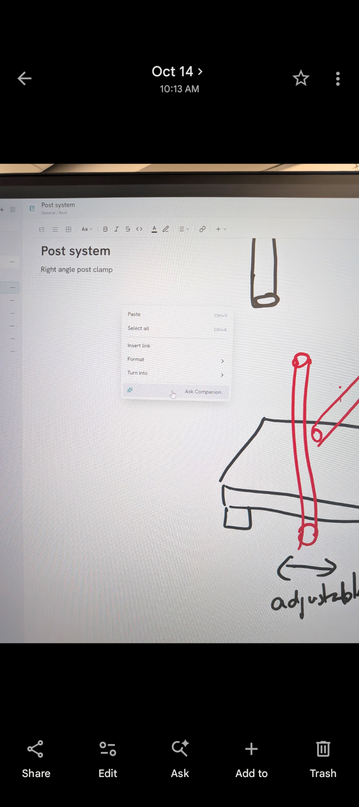
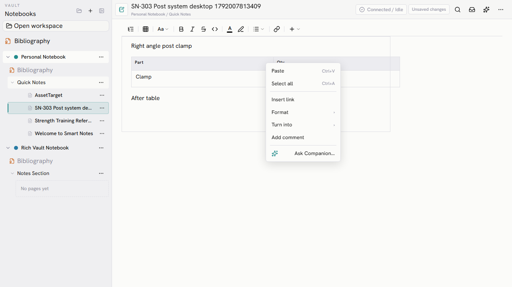
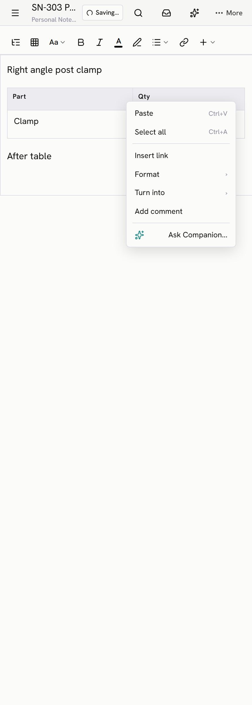
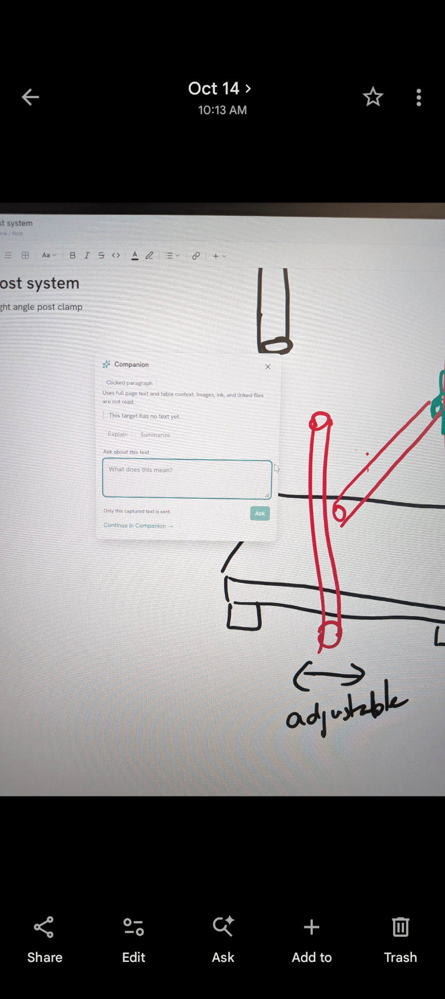
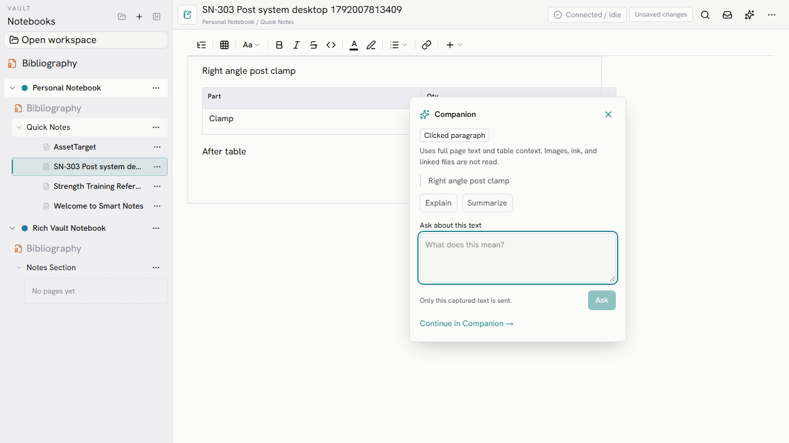
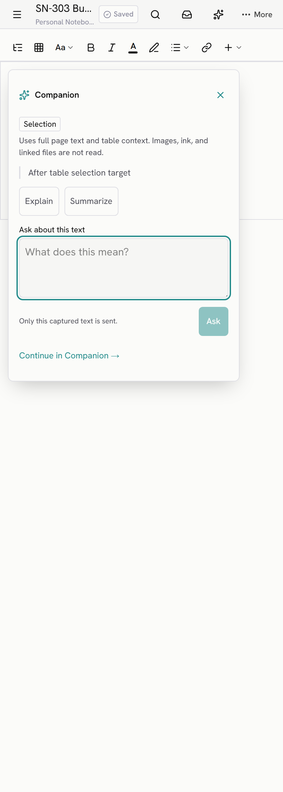

# SN-303 visual evidence

The owner attachment filenames are reversed by image content: `owner-popover.png` shows the context menu, and `owner-context-menu.png` shows the popover. The drawings in those photos are page content.

## Context menu comparison

| Owner reference | Desktop text page | Mobile text page |
| --- | --- | --- |
|  |  |  |

## Popover comparison

| Owner reference | Desktop text page | Mobile text page |
| --- | --- | --- |
|  |  |  |

## Other surfaces

| Surface | Desktop menu | Desktop popover | Mobile menu | Mobile popover |
| --- | --- | --- | --- | --- |
| Design | [Menu](desktop-design-menu.png) | [Popover](desktop-design-popover.png) | [Touch hold menu](mobile-design-menu.png) | [Popover](mobile-design-popover.png) |
| App | [Menu](desktop-app-menu.png) | [Popover](desktop-app-popover.png) | [Touch hold menu](mobile-app-menu.png) | [Popover](mobile-app-popover.png) |
| PDF | [Menu](desktop-pdf-menu.png) | [Popover](desktop-pdf-popover.png) | [Menu](mobile-pdf-menu.png) | [Popover](mobile-pdf-popover.png) |
| Table | [Menu](desktop-table-menu.png) | [Text popover](desktop-text-popover.png) | [Menu](mobile-table-menu.png) | [Text popover](mobile-text-popover.png) |

The `*-answer.png` files show the streamed answer on each surface. `mobile-text-bubble.png` and `mobile-text-bubble-popover.png` show the mobile selection entry path.
