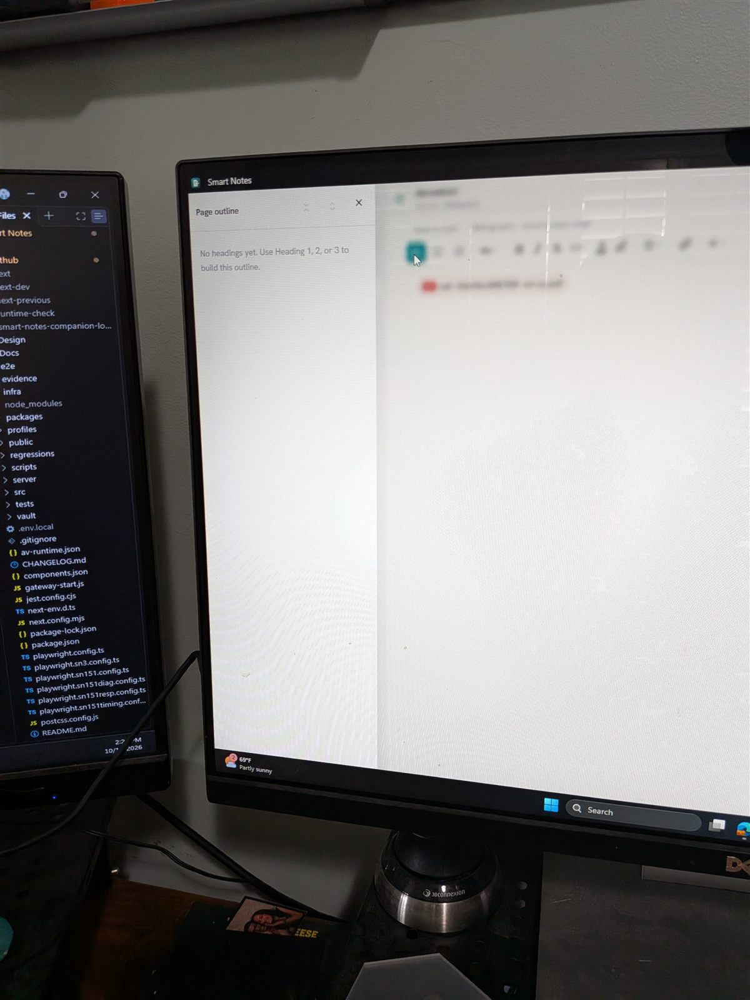
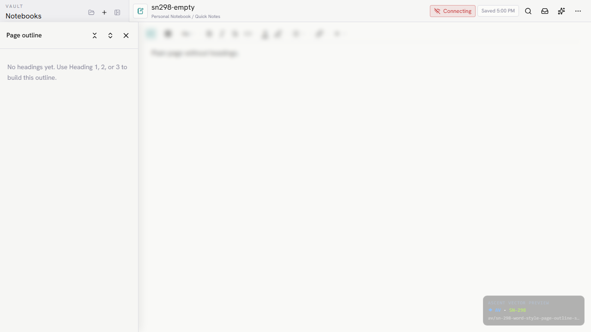

# SN-298 visual comparison

Photo #13 is a camera photo of the fork on a desktop display. The implementation screenshot uses the Playwright desktop viewport. Both show the empty outline state.

| Fork photo #13 | SN-298 desktop implementation |
| --- | --- |
|  |  |

The pane begins below the app header, occupies about 300px at the left edge, uses the same header order and empty-state copy, and blurs the page behind it. The reference is photographed at an angle, so exact pixel alignment is not available.

Additional states: [populated desktop](outline-populated-desktop.png), [empty mobile](outline-empty-mobile.png), [populated mobile](outline-populated-mobile.png).
